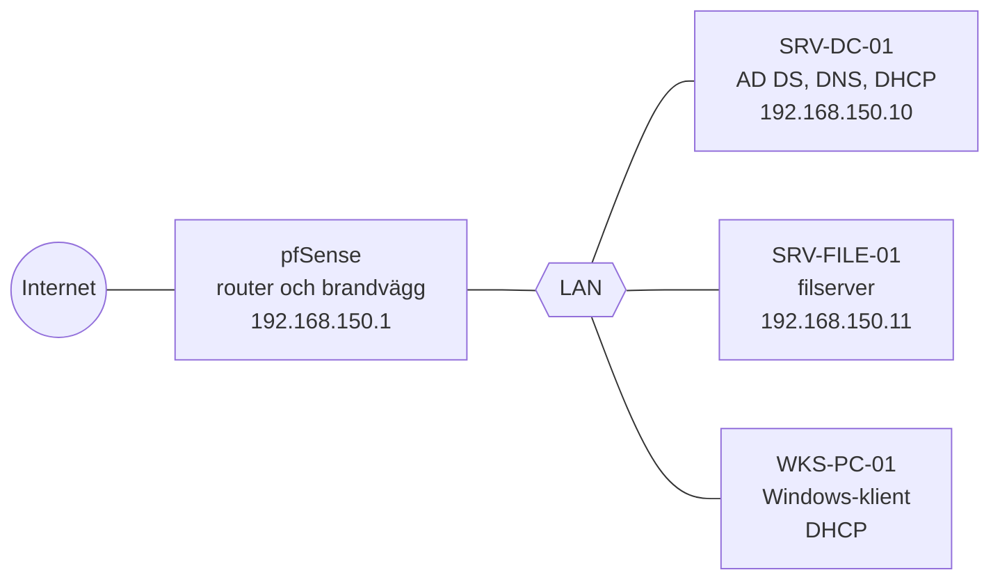
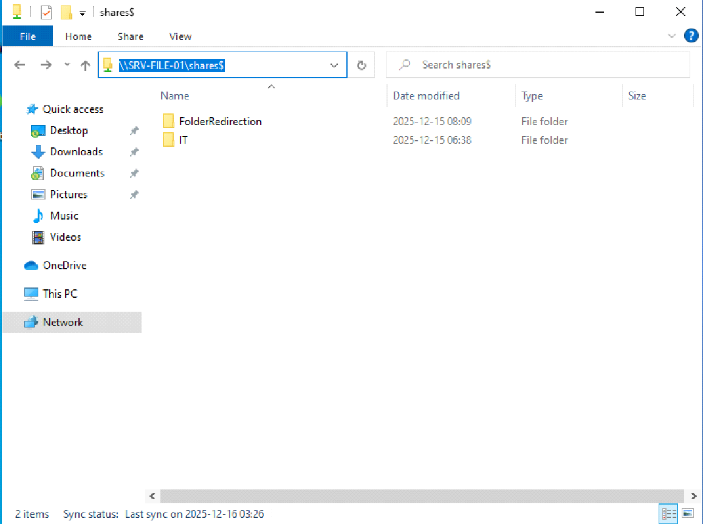

# Active Directory och PowerShell – Novatrix

En Active Directory-miljö för det fiktiva företaget Novatrix AB, byggd i Hyper-V under kursen Active Directory (Moln- och virtualiseringsspecialist, Campus Mölndal, nov–dec 2025). Projektet visar AD-design, Group Policy, filbehörigheter, automatisering med PowerShell, tillfällig adminbehörighet och byte av domänkontrollant.

> Alla företag, domäner och användare är fiktiva labbdata. Domännamnen användes bara internt i en isolerad labbmiljö.

## Innehåll

| Del | Dokument |
| --- | --- |
| OU-struktur, namngivning och AGDLP | [docs/01-ou-design-och-agdlp.md](docs/01-ou-design-och-agdlp.md) |
| Group Policy: Kontrollpanel, Drive Maps, bakgrund | [docs/02-group-policy.md](docs/02-group-policy.md) |
| Folder Redirection och Access-Based Enumeration | [docs/03-folder-redirection-och-abe.md](docs/03-folder-redirection-och-abe.md) |
| System State-backup och AD Recycle Bin | [docs/04-backup-och-recycle-bin.md](docs/04-backup-och-recycle-bin.md) |
| Byte av domänkontrollant AD01 → AD02 | [docs/05-byte-av-domankontrollant.md](docs/05-byte-av-domankontrollant.md) |
| JIT – tillfällig lokal admin | [docs/06-jit-lokal-admin.md](docs/06-jit-lokal-admin.md) |
| Felsökning och kända begränsningar | [docs/felsokning.md](docs/felsokning.md) |
| Vad som ändrats vid portföljarbetet | [CHANGES.md](CHANGES.md) |

## Mål

- Bygga en AD-struktur där behörigheter styrs med grupper enligt AGDLP, inte per användare.
- Ge alla användare samma arbetsmiljö: omdirigerade mappar, nätverksenheter per avdelning och en låst Kontrollpanel.
- Automatisera återkommande administration med PowerShell.
- Ge tillfällig lokal adminbehörighet utan permanenta adminkonton.
- Ersätta en domänkontrollant utan att användare eller data försvinner.

## Mitt bidrag

| Del | Typ |
| --- | --- |
| PowerShell-skripten (17 st) | Individuellt |
| Byte av domänkontrollant AD01 → AD02, med guide | Individuellt |
| Novatrix Secure Directory: OU-design, AGDLP, GPO, Folder Redirection, ABE, backup, Recycle Bin och säkerhetsbedömning | Gemensamt grupparbete med två gruppmedlemmar. Jag tog ansvar för och skrev en stor del av rapporten. |

## Teknik

Windows Server · Active Directory Domain Services · DNS · DHCP · Group Policy (inklusive Group Policy Preferences och item-level targeting) · Folder Redirection · SMB och NTFS · Access-Based Enumeration · Windows Server Backup · AD Recycle Bin · FSMO-roller · child domain · PowerShell (modulerna ActiveDirectory, GroupPolicy och SmbShare, WPF/XAML) · Hyper-V · pfSense

## Arkitektur

| Maskin | Roll | IP-adress | Disk |
| --- | --- | --- | --- |
| pfSense | Router och brandvägg | 192.168.150.1 | 40 GB |
| SRV-DC-01 | AD DS, DNS, DHCP | 192.168.150.10 | 60 GB |
| SRV-FILE-01 | Filserver | 192.168.150.11 | 60 GB |
| WKS-PC-01 | Testklient | DHCP, 192.168.150.99–200 | 50 GB |

Domänen heter `novatrix.se`. Användare läggs i globala grupper per avdelning (`GG_IT`), som ligger i domänlokala resursgrupper (`DL_IT_RW`) med NTFS-behörighet på avdelningens mapp.

## Implementation i korthet

1. **Grundstruktur.** Rot-OU med separata OU:er för användare per avdelning, datorer, grupper och administratörer. Användare importeras från CSV med PowerShell.
2. **Filserver.** En dold utdelning, `shares$`, med en mapp per avdelning. NTFS styr åtkomsten och ABE döljer det användaren inte har behörighet till.
3. **Group Policy.** Folder Redirection till filservern, Drive Maps med item-level targeting per avdelning, en begränsad Kontrollpanel och en gemensam bakgrund.
4. **Backup och återställning.** Schemalagd System State-backup och AD Recycle Bin, testad genom att radera och återställa en användare.
5. **JIT-admin.** En domängrupp som via GPO blir lokal admin på klienterna, och skript som lägger en användare i gruppen under en begränsad tid.
6. **Byte av DC.** En ny domänkontrollant, AD02, tar över FSMO-roller, DNS och DHCP, varefter AD01 degraderas.

## Skript

| Skript | Vad det gör |
| --- | --- |
| [`01-grundstruktur/00-Create-OUs.ps1`](scripts/01-grundstruktur/00-Create-OUs.ps1) | Skapar OU-strukturen under `OU=Novatrix` |
| [`01-grundstruktur/01-Import-NovatrixUsers-v1.ps1`](scripts/01-grundstruktur/01-Import-NovatrixUsers-v1.ps1) | Importerar användare från CSV, rensar å/ä/ö ur användarnamnen, gör dem unika och lägger användarna i `GG_<avdelning>` |
| [`01-grundstruktur/01-Import-NovatrixUsers-v2.ps1`](scripts/01-grundstruktur/01-Import-NovatrixUsers-v2.ps1) | Version 2: läser semikolonseparerad CSV med svenska rubriker (Förnamn, Efternamn, Avdelning) |
| [`01-grundstruktur/Join-NovatrixDomain.ps1`](scripts/01-grundstruktur/Join-NovatrixDomain.ps1) | Ansluter en dator till domänen och placerar den i rätt OU beroende på om den kör klient- eller serveroperativsystem |
| [`02-group-policy/02-Create-NovatrixGPOs.ps1`](scripts/02-group-policy/02-Create-NovatrixGPOs.ps1) | Skapar GPO:er för Folder Redirection och bakgrundsbilder |
| [`02-group-policy/03-Prepare-FolderRedirectionRoot.ps1`](scripts/02-group-policy/03-Prepare-FolderRedirectionRoot.ps1) | Skapar rotmappen för Folder Redirection och sätter NTFS-behörigheterna |
| [`02-group-policy/04-Link-NovatrixGPOs.ps1`](scripts/02-group-policy/04-Link-NovatrixGPOs.ps1) | Länkar GPO:erna till rätt OU |
| [`02-group-policy/05-Report-OuGpoLinks.ps1`](scripts/02-group-policy/05-Report-OuGpoLinks.ps1) | Rapporterar alla GPO-länkar per OU till CSV |
| [`03-jit-lokal-admin/06–10`](scripts/03-jit-lokal-admin) | JIT-lösningen, se [docs/06](docs/06-jit-lokal-admin.md) |
| [`04-child-domain/01–04`](scripts/04-child-domain) | För en veckouppgift med child-domänen `child.novatrix.se`: OU:er, grupper och användare, utdelningar med ABE, GPO:er och ett inloggningsskript som mappar enheter |

Vid genomgången inför portföljen hittade och rättade jag tre fel i skripten, bland annat ett som gjorde att fem skript inte gick att starta. Ändringarna och skälen finns i [CHANGES.md](CHANGES.md).

## Verifiering

Skärmbilderna kommer från grupprapporten och visar att inställningarna fungerade på klienten.

*Access-Based Enumeration: en testanvändare som öppnar `\\SRV-FILE-01\shares$` ser bara `FolderRedirection` och `IT`.*

| Test | Resultat | Bevis |
| --- | --- | --- |
| Folder Redirection | Skrivbordet ligger på `\\SRV-FILE-01\shares$\FolderRedirection\<användare>` | [Skärmbild 04](screenshots/04-folder-redirection-klient.png) |
| ABE | Användaren ser bara mappar den har behörighet till | [Skärmbild 09](screenshots/09-abe-resultat-klient.png) |
| Drive Maps | En IT-användare får enheten I: mot IT-mappen | [Skärmbild 16](screenshots/16-drive-map-klient.png) |
| Kontrollpanel | Bara Devices and Printers syns för standardanvändare | [Skärmbild 12](screenshots/12-kontrollpanel-klient.png) |
| AD Recycle Bin | En raderad användare återställdes från Deleted Objects i ADAC | Rapporttext, ingen skärmbild |
| Byte av DC | Slutkontrollen i guiden: användare, data, Folder Redirection och DNS efter att AD01 avvecklats | Min guide, ingen skärmbild |
| JIT-skripten | – | Ingen skärmbild finns |

## Säkerhet

- **AGDLP och minsta möjliga behörighet:** NTFS-behörighet ges bara till domänlokala grupper och aldrig direkt till användare.
- **ABE och dold utdelning:** användare ser inte mappar de saknar behörighet till.
- **Share och NTFS:** share-behörigheten är `Everyone: Full Control` och NTFS gör begränsningen. Det är ett vanligt mönster, men `Authenticated Users` hade varit ett stramare val.
- **Ingen permanent lokal admin:** JIT-lösningen ger adminrätt för en bestämd tid och loggar varje ändring.
- **Inga lösenord i skript:** startlösenord anges vid körning med `Read-Host -AsSecureString`, och användarna måste byta det vid första inloggning.
- **Låst användarmiljö:** standardanvändare når bara de delar av Kontrollpanelen de behöver.

Gruppens säkerhetsbedömning lyfte också fram följande:

- GPO:er ska testas i en test-OU innan de används i produktion.
- Adminkonton ska inte användas för dagligt arbete.
- Inaktiva konton ska identifieras och inaktiveras.

## Lärdomar

- **Planera innan man bygger.** Rätt OU-struktur och gruppnamn från början sparar mycket omarbete.
- **Ta en snapshot före större ändringar,** till exempel i GPO:er, så att det går att backa.
- **Testa återställningen tidigt.** En backup är inte bevisad förrän den har återställts.
- **Gruppmedlemskap sitter i Kerberos-biljetten.** Därför slår JIT-behörighet igenom först efter ny inloggning.
- **Testa skript innan de sparas som färdiga.** Felen som hittades vid portföljarbetet – `"$variabel:"` i strängar och att `Read-Host` returnerar en sträng – hade synts vid första körningen.

## Återskapa labbet

1. Skapa fyra VM:ar i Hyper-V enligt tabellen ovan: pfSense med ett WAN- och ett LAN-kort, samt de andra tre på LAN.
2. Installera AD DS, DNS och DHCP på SRV-DC-01 och skapa domänen. Använd en egen labbdomän, till exempel `lab.local`, och justera sökvägarna i skripten.
3. Kör `00-Create-OUs.ps1` och ett av importskripten med en egen CSV-fil.
4. Anslut SRV-FILE-01 och WKS-PC-01 till domänen med `Join-NovatrixDomain.ps1` eller manuellt.
5. Skapa utdelningen och avdelningsmapparna på SRV-FILE-01, slå på ABE och sätt NTFS enligt [docs/03](docs/03-folder-redirection-och-abe.md).
6. Skapa och länka GPO:erna med skripten i `02-group-policy`, och ställ in Folder Redirection och Drive Maps i GPMC.
7. Logga in på klienten som testanvändare och kontrollera resultatet med `gpresult /r`.

Kör skripten i en isolerad testmiljö, aldrig direkt i en produktionsdomän.
