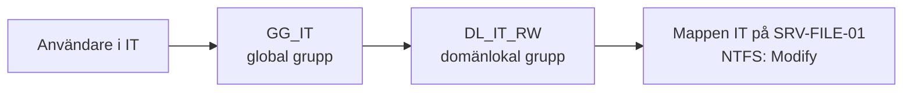

# OU-design och AGDLP

**Typ:** gemensamt grupparbete (Novatrix Secure Directory, dec 2025) och egna skript.

## OU-struktur

Domänen `novatrix.se` har en rot-OU, `Novatrix`, som håller isär användare, datorer, grupper och administrativa konton. Strukturen nedan är den som byggdes i grupparbetet och syns i [skärmbild 01](../screenshots/01-ou-struktur.png).

```text
DC=novatrix,DC=se
└── OU=Novatrix
    ├── OU=Admins
    ├── OU=Computers
    │   ├── OU=Servers
    │   └── OU=Workstations
    ├── OU=Groups
    │   ├── OU=Distribution
    │   └── OU=Security
    └── OU=Users
        ├── OU=Ekonomi
        ├── OU=IT
        ├── OU=Lager
        ├── OU=Marknad
        ├── OU=Sälj
        └── OU=VD
```

Varför den här uppdelningen:

- GPO:er kan länkas per användartyp och avdelning utan att träffa fel objekt.
- Användare, datorer och adminkonton ligger åtskilda, vilket gör delegering enklare.
- En ny avdelning blir en ny OU och två nya grupper, utan att befintliga påverkas.

Skriptet [`00-Create-OUs.ps1`](../scripts/01-grundstruktur/00-Create-OUs.ps1) bygger en närliggande variant: `Clients` i stället för `Computers`, en gemensam `Users\Standard`-OU och en egen `ServiceAccounts`-OU.

## Namngivning

| Objekt | Mönster | Exempel |
| --- | --- | --- |
| Användarkonto | förnamn.efternamn | `anna.andersson` |
| Global grupp (roll/avdelning) | `GG_<avdelning>` | `GG_IT` |
| Domänlokal grupp (resurs) | `DL_<avdelning>_RW` | `DL_IT_RW` |

Importskripten skapar användarnamnen automatiskt: å, ä och ö tas bort, otillåtna tecken rensas och en siffra läggs till om namnet redan finns.

## AGDLP

Behörigheter ges aldrig direkt till en användare. Användaren läggs i en global grupp för sin roll, den globala gruppen läggs i en domänlokal grupp för resursen, och bara den domänlokala gruppen får NTFS-behörighet.



När någon byter avdelning ändras bara gruppmedlemskapet. Kedjan går att följa från användare till behörighet, vilket förenklar felsökning.

| Avdelning | Global grupp | Domänlokal grupp | NTFS | Enhet |
| --- | --- | --- | --- | --- |
| Ekonomi | GG_Ekonomi | DL_Ekonomi_RW | Modify | E: |
| IT | GG_IT | DL_IT_RW | Modify | I: |
| Lager | GG_Lager | DL_Lager_RW | Modify | L: |
| Marknad | GG_Marknad | DL_Marknad_RW | Modify | M: |
| Sälj | GG_Sälj | DL_Sälj_RW | Modify | S: |
| VD | GG_VD | DL_VD_RW | Modify | V: |
