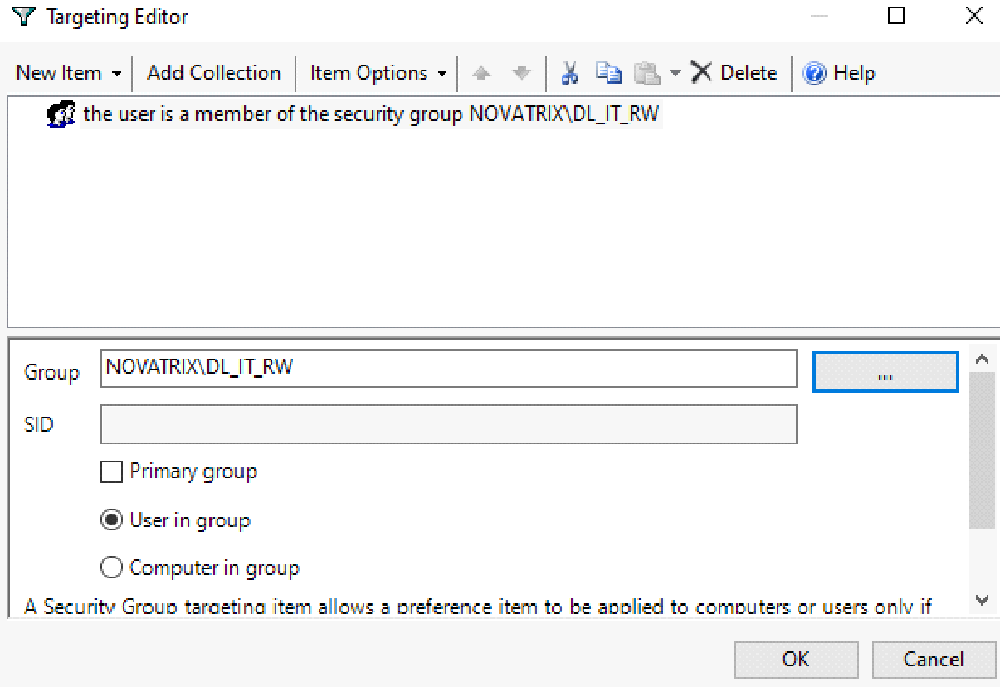

# Group Policy – användarmiljö

**Typ:** gemensamt grupparbete (Novatrix Secure Directory, dec 2025) och egna skript.

Tre GPO:er är länkade till OU:n `Users` och styr användarnas miljö ([skärmbild 02](../screenshots/02-gpo-lankar-och-filtrering.png)):

| GPO | Inställning | Syfte |
| --- | --- | --- |
| Control Panel Restriction | Show only specified Control Panel items | Standardanvändare ser bara Enheter och skrivare |
| Drive Maps | Group Policy Preferences → Drive Maps med item-level targeting | Varje avdelning får sin egen nätverksenhet |
| Folder Redirection | Skrivbordet omdirigeras till filservern | Användardata sparas centralt, se [Folder Redirection och ABE](03-folder-redirection-och-abe.md) |

## Begränsad Kontrollpanel

`User Configuration → Policies → Administrative Templates → Control Panel → Show only specified Control Panel items` är aktiverad med objektet `Microsoft.DevicesAndPrinters`. Det minskar risken att användare ändrar systeminställningar men låter dem fortfarande hantera skrivare.

| Skärmbild | Visar |
| --- | --- |
| [10](../screenshots/10-kontrollpanel-gpo.png) | Inställningen aktiverad i GPO:n |
| [11](../screenshots/11-kontrollpanel-tillatna-objekt.png) | Listan med tillåtna objekt |
| [12](../screenshots/12-kontrollpanel-klient.png) | Resultatet på klienten: bara Devices and Printers syns |

## Drive Maps med item-level targeting

`User Configuration → Preferences → Windows Settings → Drive Maps`. Varje enhet har åtgärden **Create**, återanslutning påslagen och ett targeting-villkor så att den bara mappas för användare i rätt grupp.

| Enhet | Sökväg | Villkor |
| --- | --- | --- |
| E: | `\\SRV-FILE-01\shares$\Ekonomi` | Användaren är medlem i DL_Ekonomi_RW |
| I: | `\\SRV-FILE-01\shares$\IT` | Användaren är medlem i DL_IT_RW |
| L: | `\\SRV-FILE-01\shares$\Lager` | Användaren är medlem i DL_Lager_RW |
| M: | `\\SRV-FILE-01\shares$\Marknad` | Användaren är medlem i DL_Marknad_RW |
| S: | `\\SRV-FILE-01\shares$\Sälj` | Användaren är medlem i DL_Sälj_RW |
| V: | `\\SRV-FILE-01\shares$\VD` | Användaren är medlem i DL_VD_RW |

*Targeting-villkoret för I: – användaren måste vara medlem i `NOVATRIX\DL_IT_RW`. Gruppens SID är maskerat.*

Övriga skärmbilder: [13 – listan med enheter](../screenshots/13-drive-maps.png), [14 – inställningarna för I:](../screenshots/14-drive-map-it.png) och [16 – enheten I: på klienten](../screenshots/16-drive-map-klient.png).

## Skrivbordsbakgrund

Gruppen satte en gemensam bakgrund via `User Configuration → Policies → Administrative Templates → Desktop → Desktop → Desktop Wallpaper`, med bilden i NETLOGON och stilen Fill. Det finns ingen skärmbild av den GPO:n.

## Skript för GPO:er

| Skript | Vad det gör |
| --- | --- |
| [`02-Create-NovatrixGPOs.ps1`](../scripts/02-group-policy/02-Create-NovatrixGPOs.ps1) | Skapar en GPO för Folder Redirection (själva omdirigeringen ställs in i GPMC) och två bakgrunds-GPO:er, en för användare och en för admins, via `Set-GPRegistryValue` |
| [`04-Link-NovatrixGPOs.ps1`](../scripts/02-group-policy/04-Link-NovatrixGPOs.ps1) | Länkar GPO:erna till rätt OU och justerar ordningen om länken redan finns |
| [`05-Report-OuGpoLinks.ps1`](../scripts/02-group-policy/05-Report-OuGpoLinks.ps1) | Listar alla GPO-länkar under rot-OU:n och exporterar dem till CSV för granskning |

Folder Redirection och Drive Maps går inte att ställa in fullt ut med GroupPolicy-modulen, så skripten skapar och länkar GPO:erna medan inställningarna görs i GPMC.
