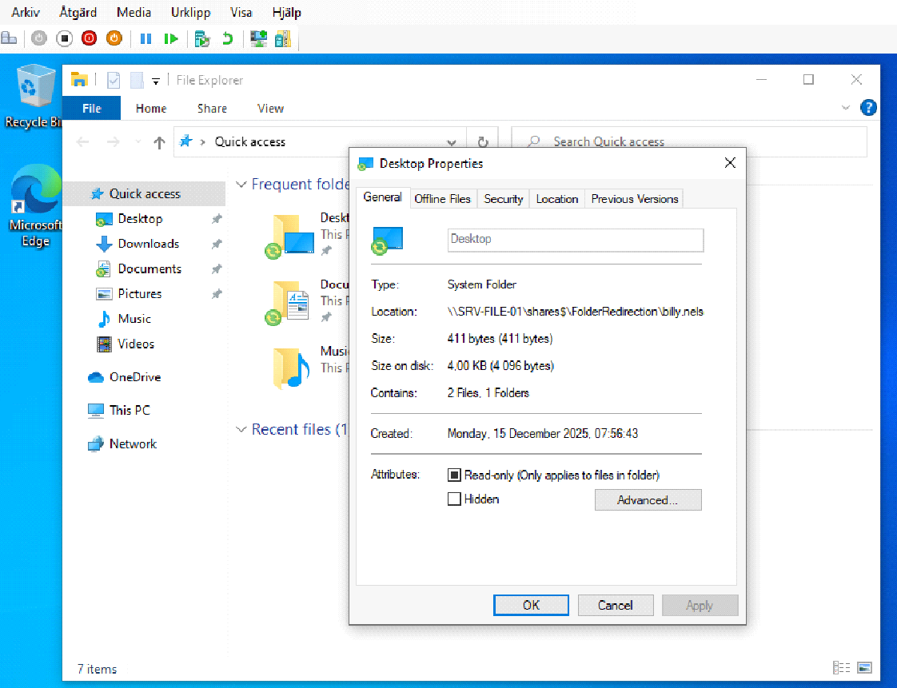
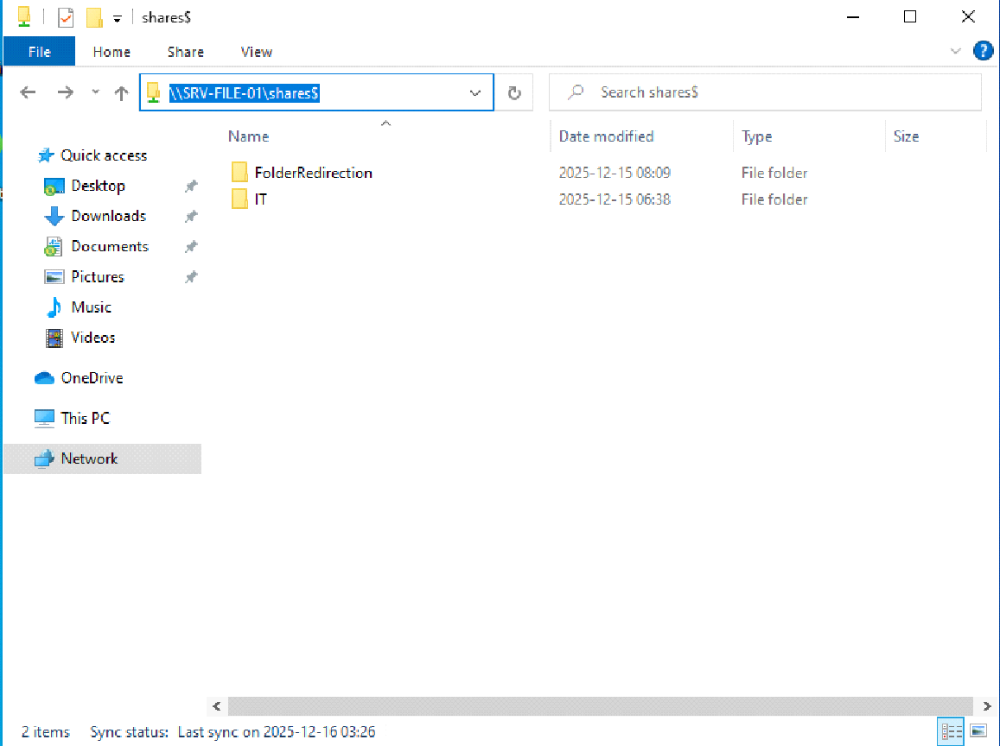

# Folder Redirection och Access-Based Enumeration

**Typ:** gemensamt grupparbete (Novatrix Secure Directory, dec 2025) och ett eget skript.

## Folder Redirection

Användarnas mappar sparas på filservern i stället för lokalt. Det ger central backup och gör att filerna följer med användaren mellan datorer.

| Inställning | Värde |
| --- | --- |
| GPO | Folder Redirection, länkad till OU:n `Users` |
| Sökväg i GPO | `User Configuration → Policies → Windows Settings → Folder Redirection` |
| Mapp som visas i skärmbild | Desktop (rapporten nämner även Documents) |
| Inställning | Basic – Redirect everyone's folder to the same location |
| Målmapp | Create a folder for each user under the root path |
| Rotsökväg | `\\SRV-FILE-01\shares$\FolderRedirection` |

NTFS-behörigheter på rotmappen, enligt minsta möjliga behörighet:

| Konto | Behörighet |
| --- | --- |
| SYSTEM | Full Control |
| Administrators | Full Control |
| CREATOR OWNER | Full Control, bara på undermappar och filer |
| Domain Users | List folder / Read data och Create folders |

Effekten: varje användare kan skapa sin egen mapp och blir ägare till den. Enligt rapporten har bara användaren och administratörerna åtkomst till respektive användarmapp.

Skriptet [`03-Prepare-FolderRedirectionRoot.ps1`](../scripts/02-group-policy/03-Prepare-FolderRedirectionRoot.ps1) sätter samma typ av behörigheter med PowerShell. Det använder Authenticated Users och Domain Admins i stället för Domain Users och Administrators.

*På klienten WKS-PC-01 pekar Skrivbordet på `\\SRV-FILE-01\shares$\FolderRedirection\<användare>`, skapad 15 december 2025.*

Se även [skärmbild 03 – inställningen i GPO:n](../screenshots/03-folder-redirection-gpo.png).

## Utdelningar och Access-Based Enumeration

Alla avdelningsmappar ligger under en dold utdelning, `\\SRV-FILE-01\shares$` (`C:\shares` på servern). Access-Based Enumeration (ABE) är aktiverat på utdelningen, så användare ser bara de mappar de har behörighet till.

Åtkomsten styrs av NTFS. Share-behörigheten är `Everyone: Full Control`, ett vanligt mönster där NTFS gör den egentliga begränsningen. Arvet är avstängt på varje avdelningsmapp, som får:

| Konto | Behörighet |
| --- | --- |
| DL_\<avdelning\>_RW | Modify |
| Administrators | Full Control |
| SYSTEM | Full Control |

*En testanvändare öppnar `\\SRV-FILE-01\shares$` och ser bara `FolderRedirection` och `IT` – övriga avdelningsmappar är dolda av ABE.*

| Skärmbild | Visar |
| --- | --- |
| [05](../screenshots/05-abe-aktiverat.png) | ABE aktiverat på `shares$` |
| [06](../screenshots/06-share-behorighet.png) | Share-behörigheten |
| [07](../screenshots/07-utdelningar-filserver.png) | Utdelningarna på SRV-FILE-01 |
| [08](../screenshots/08-ntfs-it-mappen.png) | NTFS på mappen IT, med arvet avstängt |

## Beslut: ingen DFS-sökväg

Gruppen pekade Folder Redirection direkt mot filservern i stället för mot en DFS-sökväg, för att hålla kedjan enkel och undvika ett extra lager vid felsökning.

## Skript för utdelningar (child-domän)

[`02-Create-SharesFolders.ps1`](../scripts/04-child-domain/02-Create-SharesFolders.ps1) skapar en gemensam utdelning och en utdelning per avdelningsgrupp, stänger av arv, sätter NTFS och slår på ABE (`-FolderEnumerationMode AccessBased`). Det skrevs för child-domänen `child.novatrix.se`.
