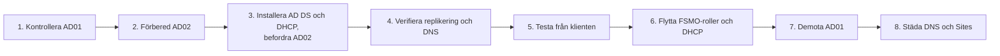

# Byte av domänkontrollant: AD01 → AD02

**Typ:** individuell uppgift (Projekt IT-infrastruktur del 11, dec 2025). Guiden nedan är min inlämnade guide i bearbetad form. Det som lagts till vid portföljarbetet är tydligt märkt. Det finns inga skärmbilder från bytet.

## Mål

Ersätta domänkontrollanten AD01 med AD02 i domänen `novatrix.se` utan att användare, grupper, GPO:er eller data försvinner, och sedan avveckla AD01.

| Maskin | Roll |
| --- | --- |
| AD01 | Första domänkontrollanten, skapade domänen och OU-strukturen |
| AD02 | Ny domänkontrollant som tar över |
| FILE-01 | Filserver: gemensam mapp och omdirigerade mappar |
| PC-01 | Testklient |

## Förutsättningar

- AD01 är en fungerande domänkontrollant och DNS-server för `novatrix.se`.
- FILE-01 är medlem i domänen och används som filserver.
- Minst fem användare finns, och Folder Redirection pekar mot FILE-01.
- Minst en klient, PC-01, är ansluten till domänen.
- En fullständig backup av AD01 finns.



## Steg

**1. Kontrollera AD01.** Logga in som domänadministratör och kontrollera att AD och DNS fungerar och att OU:er, användare och grupper finns.

**2. Förbered AD02.** Statisk IP-adress, DNS som pekar på AD01, datornamnet AD02. Anslut AD02 till domänen.

**3. Installera AD DS och DHCP på AD02.** Installera rollerna och välj **Promote this server to a domain controller → Add a domain controller to an existing domain**. Starta om.

> **Tillägg:** kontrollera i guiden att AD02 blir DNS-server och Global Catalog. Båda är förvalda, men utan dem fungerar inte inloggning och namnuppslag när AD01 är borta.

**4. Verifiera AD02.**

```powershell
repadmin /showrepl          # replikeringen mellan AD01 och AD02
```

Kontrollera i DNS Manager att forward- och reverse-zonerna finns på AD02, och i Active Directory Sites and Services att AD02 syns och är synkad.

> **Tillägg:** `dcdiag` och `repadmin /replsummary` ger en snabb hälsokontroll av båda domänkontrollanterna.

**5. Testa från klienten.** Logga in på PC-01 med en testanvändare och kontrollera inloggning, Folder Redirection och den gemensamma mappen på FILE-01.

**6. Flytta FSMO-roller och DHCP till AD02.**

```powershell
netdom query fsmo                                   # vem har rollerna nu
Move-ADDirectoryServerOperationMasterRole -Identity AD02 -OperationMasterRole 0,1,2,3,4
```

`0,1,2,3,4` motsvarar PDC Emulator, RID Master, Infrastructure Master, Schema Master och Domain Naming Master. Kontot som kör kommandot måste vara medlem i Enterprise Admins och, för Schema Master, Schema Admins.

DHCP flyttas genom export på AD01 och import på AD02:

```powershell
# På AD01
netsh dhcp server export C:\Temp\dhcp-backup.txt all
# På AD02
netsh dhcp server import C:\Temp\dhcp-backup.txt all
Add-DhcpServerInDC -DnsName AD02.novatrix.se -IPAddress 192.168.150.11
```

Stäng sedan av DHCP på AD01 så att två servrar inte delar ut adresser samtidigt.

> **Tillägg:** `Export-DhcpServer` och `Import-DhcpServer` är PowerShell-alternativet till netsh.

**7. Förbered avvecklingen.** Innan AD01 tas bort ska alla FSMO-roller ligga på AD02, DNS fungera utan AD01, användare kunna logga in och FILE-01 fungera.

> **Tillägg:** peka om DNS till AD02 på FILE-01, på klienterna och i DHCP-scopets DNS-alternativ innan AD01 demotas. Annars försöker maskinerna fortfarande fråga AD01.

**8. Demota AD01.** Ta bort rollen Active Directory Domain Services i Server Manager och välj att degradera servern, eller med PowerShell:

```powershell
Uninstall-ADDSDomainController -DemoteOperationMasterRole -Force `
    -LocalAdministratorPassword (Read-Host -AsSecureString "Nytt lokalt administratörslösenord för AD01")
```

> **Rättelse:** `-LocalAdministratorPassword` är lösenordet för det lokala administratörskontot som servern får efter degraderingen, inte DSRM-lösenordet. I inlämningen stod ett lösenord i klartext; här frågas det efter vid körning.

**9. Städa efter AD01.** Ta bort gamla DNS-poster för AD01 och kontrollera i Active Directory Sites and Services att AD01 inte längre finns.

## Slutkontroll

- Alla användare finns kvar.
- Användarnas data finns kvar på FILE-01.
- Folder Redirection fungerar.
- AD02 är ensam domänkontrollant.
- Domänen och DNS fungerar normalt.

## Problem jag stötte på

| Problem | Lösning |
| --- | --- |
| FSMO-rollerna gick inte att flytta till AD02 | Kontrollerade vilka grupper administratörskontot var medlem i – flytten kräver rätt gruppmedlemskap (se steg 6) |
| GPO:er applicerades inte på klienten | `gpresult /r` för att se vilka GPO:er som gällde, sedan `gpupdate /force /logoff` |
