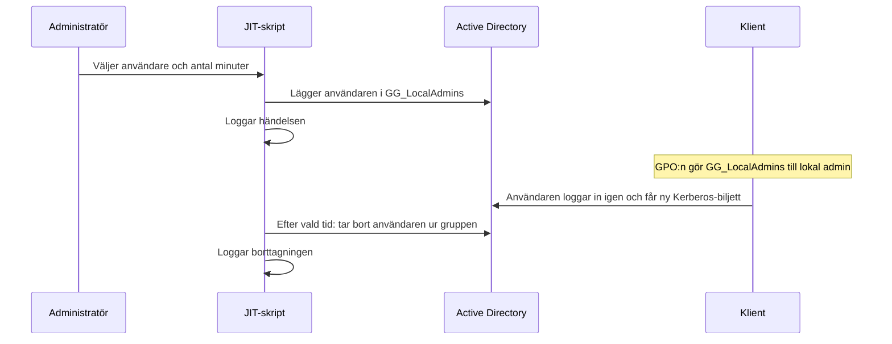

# JIT – tillfällig lokal admin

**Typ:** egna skript (Active Directory-kursen, nov–dec 2025). Det finns ingen skärmbild av verktyget i drift.

## Problemet

Användare behöver ibland lokal adminbehörighet på sin dator, till exempel för att installera ett program. Permanenta adminrättigheter bryter mot principen om minsta möjliga behörighet. Lösningen ger behörigheten för en bestämd tid och loggar vem som fick den.

## Hur det fungerar

1. Domängruppen `GG_LocalAdmins` skapas ([`06-Create-LocalAdminGroup.ps1`](../scripts/03-jit-lokal-admin/06-Create-LocalAdminGroup.ps1)).
2. GPO:n `NOV-LocalAdmins-Clients` länkas till OU:n med arbetsstationer ([`07-Link-LocalAdminGPO.ps1`](../scripts/03-jit-lokal-admin/07-Link-LocalAdminGPO.ps1)). I GPMC läggs `NOVATRIX\GG_LocalAdmins` till i den inbyggda gruppen Administrators via `Computer Configuration → Preferences → Control Panel Settings → Local Users and Groups`, med åtgärden **Update**. Update lägger till gruppen utan att ta bort befintliga medlemmar.
3. Ett JIT-skript lägger användaren i `GG_LocalAdmins`, väntar den valda tiden och tar sedan bort användaren. Varje händelse loggas.



## Tre versioner

| Skript | Typ | Beskrivning |
| --- | --- | --- |
| [`08-Add-TempLocalAdmin.ps1`](../scripts/03-jit-lokal-admin/08-Add-TempLocalAdmin.ps1) | Första version | Tre rader: lägg till, vänta 60 minuter, ta bort |
| [`09-JIT-LocalAdmin.ps1`](../scripts/03-jit-lokal-admin/09-JIT-LocalAdmin.ps1) | Konsol | Frågar efter användare och minuter, kontrollerar att användare och grupp finns, visar nedräkning och loggar till `C:\JIT-Logs\JIT-Log.txt` |
| [`10-JIT-LocalAdmin-GUI.ps1`](../scripts/03-jit-lokal-admin/10-JIT-LocalAdmin-GUI.ps1) | Grafiskt (WPF/XAML) | Listar aktiverade användare från AD, ger och tar bort JIT, visar aktuella medlemmar och kör borttagningen som ett bakgrundsjobb |

## Begränsningar

- **Kerberos-biljetten.** Gruppmedlemskap läses in vid inloggning. Användaren måste logga ut och in för att få adminrätten, och en pågående session behåller rätten efter borttagningen tills användaren loggar ut.
- **Borttagningen hänger på PowerShell-processen.** I konsolversionen måste fönstret vara öppet hela tiden. I GUI-versionen dör bakgrundsjobbet om PowerShell stängs – det står också i verktygets eget fönster.
- **Version 08** låser konsolen i 60 minuter.
- **Fel som rättats vid portföljarbetet:** nedräkningen i version 09 avbröts efter första minuten, eftersom `Read-Host` returnerar en sträng. GUI-versionen innehöll ett parserfel. Båda beskrivs i [CHANGES.md](../CHANGES.md).

## Nästa steg (förslag, inte genomfört)

Active Directory har inbyggt tidsbegränsat gruppmedlemskap via Privileged Access Management-funktionen (kräver forest functional level Windows Server 2016). Då tar AD själv bort medlemskapet när tiden gått ut, oberoende av något skript, och Kerberos-biljettens livslängd begränsas till den återstående tiden.

```powershell
# Engångsaktivering, går inte att ångra
Enable-ADOptionalFeature -Identity 'Privileged Access Management Feature' -Scope ForestOrConfigurationSet -Target 'novatrix.se'

# Medlemskap i 60 minuter
Add-ADGroupMember -Identity 'GG_LocalAdmins' -Members 'test.user' -MemberTimeToLive (New-TimeSpan -Minutes 60)
```
